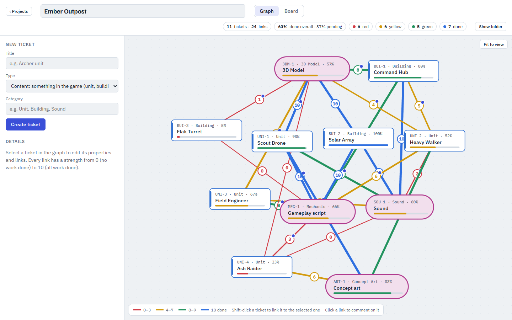
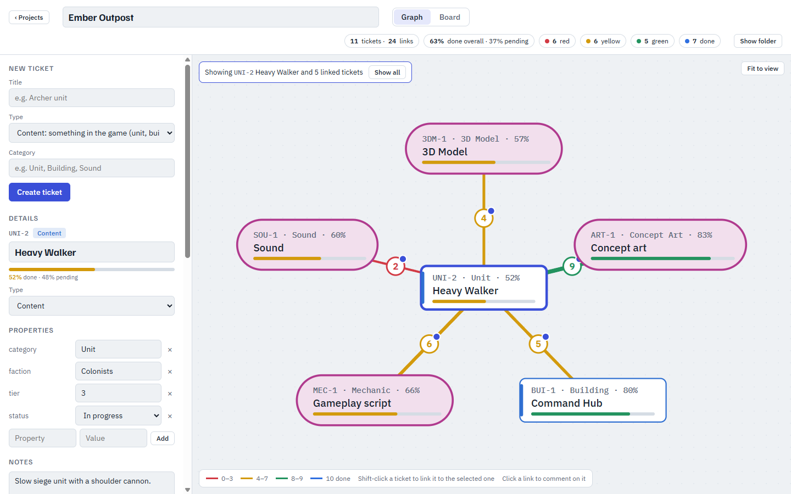
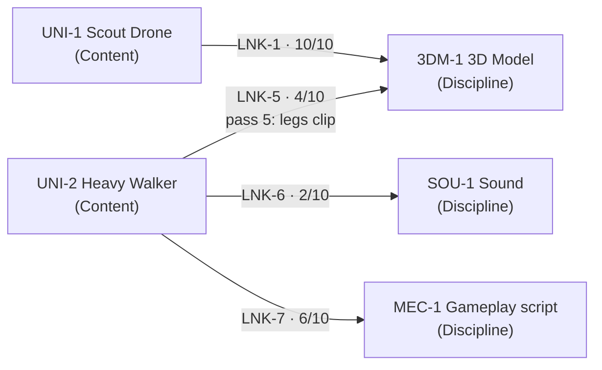
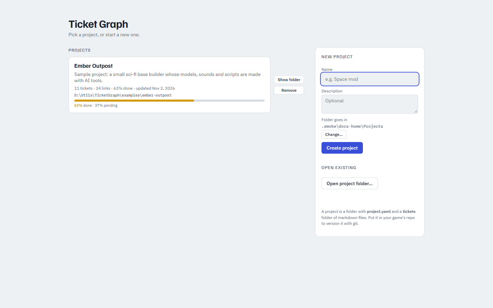
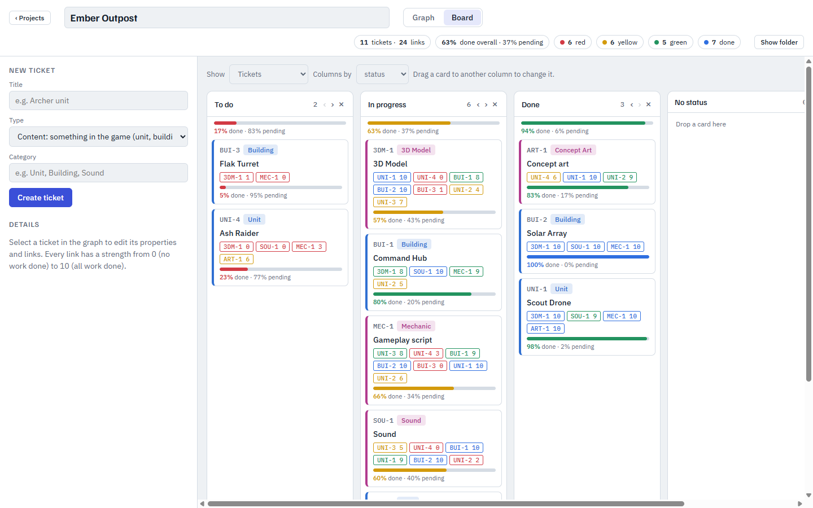
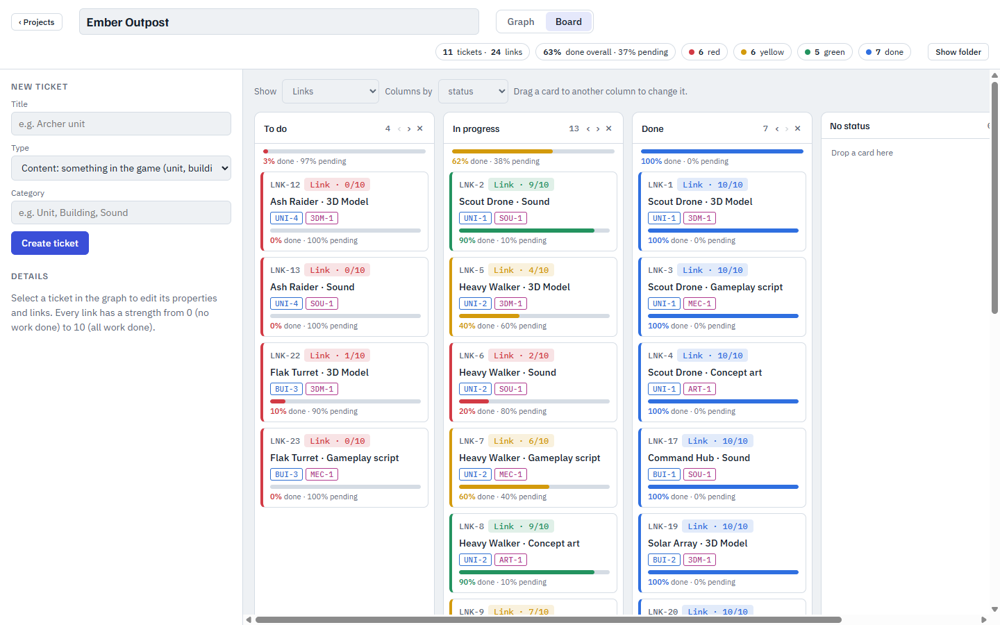
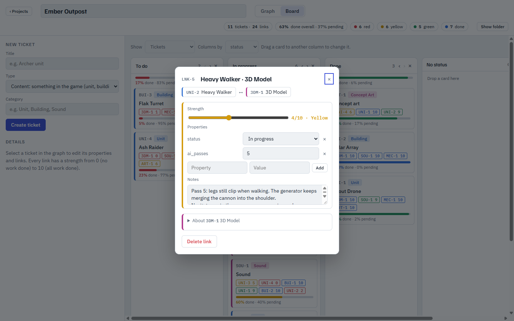

# Ticket Graph

**A personal project tracker for AI-assisted work.** Every ticket, and every link between two tickets, is a plain markdown file. Each link has a strength from 0 to 10 that tells you how close that piece of work is to done, so you can see how many more AI passes it is likely to need.

Open source (MIT). Runs as a local web app or a desktop app, and comes with an **MCP server** so Claude (or any MCP client) can read and update your project for you.



## Why it exists

When AI does the work, the work is **arbitrary**. A generated 3D model, sound effect or script is rarely right the first time. Sometimes the first pass is shippable; sometimes the fifth pass still has the cannon fused into the shoulder. "Done / not done" doesn't capture that, and neither does a story-point estimate made before anyone saw the output.

Ticket Graph tracks **how strong each piece of work is right now** instead:

- A **Link** connects a thing in your game to a kind of work, e.g. *Heavy Walker · 3D Model*. That link **is** the task.
- Its **strength (0-10)** is your honest read of the current output: 0 means nothing usable, 10 means ship it. After each AI pass you move the slider.
- Its **notes** keep the iteration history: what the last pass got wrong and what to try next. Add an `ai_passes` property if you want to count attempts.
- Weak links (red, 0-3) are where the next iterations should go. Strong links (green, 8-9) need polish, not regeneration.

Progress rolls up from the links. Heavy Walker is 52% done because its five links average 5.2 out of 10, and the 3D Model discipline is 57% done across everything that needs a model. Nobody has to estimate anything up front.



## How it fits together



Three ticket types, and that's all:

| Type | What it is | Examples |
|---|---|---|
| **Content** | A thing in your project. Its kind goes in the `category` property. | Units, buildings, levels, characters |
| **Discipline** | A kind of work many things depend on. Usually an AI tool or skill. | 3D Model, Sound, Gameplay script, Concept art |
| **Link** | The piece of work between two tickets. Has a strength 0-10, a status and notes. | *Heavy Walker · 3D Model*, 4/10, "legs clip" |

Strength bands: **0-3 red** (regenerate), **4-7 yellow** (iterate), **8-9 green** (polish), **10 blue** (done).

## A personal tool

Ticket Graph is built for one person, or one person plus their AI agents, running their own project:

- **Local first.** Your data is a folder of markdown files on your machine. There are no accounts, no server and no sync service. The web server only listens on `localhost`.
- **Plain files.** One file per ticket and per link, so you can edit them in VS Code, grep them, and put the folder in your game's git repo. Diffs show exactly which piece of work moved.
- **Several projects.** The start screen lists your project folders; create one or open an existing one from anywhere.



## Built for AI agents (MCP)

The MCP server (`mcp/server.mjs`) gives Claude the same view of the project you have. It can:

- Report: "what's still red on Sound?", "how far along is the 3D Model work overall?"
- Record a pass: "Heavy Walker's model is at 6 now, legs fixed, the cannon is still fused" sets the strength, appends the note and counts the pass.
- Plan: create tickets for new units and link them to every discipline at 0.
- Organise: rename board columns, move work between statuses.

Changes made by an agent show up in the open app within half a second, because both work on the same files. The tools enforce the rules (stable keys, valid statuses, links titled after their two tickets), and anything destructive asks first.

This repo includes [`CLAUDE.md`](CLAUDE.md), [`.mcp.json`](.mcp.json) and a [`ticket-graph` skill](.claude/skills/ticket-graph/SKILL.md), so a Claude Code session opened in a clone already knows how to use the tool.

## The board

Columns come from any property (`status` by default), and you can add, rename and reorder them. Every card and column shows how much of its work is done. Link chips on a card open that piece of work.



Switch the board to **Links** to see the individual pieces of work, grouped by their own status:



Click any link (a line in the graph, a chip on a card, or a link card) to open it as a ticket of its own: strength, status, AI pass count and notes.



## The files

The sample project lives in [`examples/ember-outpost`](examples/ember-outpost): 11 tickets and 24 links for a small sci-fi base builder.

```
examples/ember-outpost/
  project.yaml                               # name, description, board columns
  tickets/
    UNI-2-heavy-walker.md                    # Content
    3DM-1-3d-model.md                        # Discipline
    LNK-5-heavy-walker-3d-model.md           # Link
```

[`LNK-5-heavy-walker-3d-model.md`](examples/ember-outpost/tickets/LNK-5-heavy-walker-3d-model.md):

```markdown
---
key: LNK-5
title: Heavy Walker · 3D Model
type: Link
between: [ UNI-2, 3DM-1 ]
strength: 4
status: In progress
ai_passes: "5"
created: 2026-10-20T09:00:00.000Z
---

Pass 5: legs still clip when walking. The generator keeps merging the cannon into the shoulder.
Next: generate the cannon as a separate mesh.
```

The fixed front-matter fields are `key`, `title`, `type`, `between` and `strength` (links only), and `created`. Every other field is a free-form property. Everything after the front matter is notes. Keys never change; the file name follows the title.

## Run it

Requires Node 20 or newer.

```bash
git clone https://github.com/zetawars/ticket-graph
cd ticket-graph
npm install --omit=dev      # web app + MCP server (no Electron)
npm run web                 # http://localhost:4387
```

The sample project shows up on the start screen when you run with `TG_PROJECTS=examples`. To open it otherwise, use **Open project folder…** and point it at `examples/ember-outpost`.

Desktop app (Electron wraps the same web server and adds native folder dialogs):

```bash
npm install                 # includes Electron
npm start                   # run it
npm run dist                # Windows installer in dist/
```

Use the MCP server from any Claude Code session, not just this repo, by adding it at user scope:

```json
"ticket-graph": { "type": "stdio", "command": "node", "args": ["/path/to/ticket-graph/mcp/server.mjs"] }
```

### Settings

| Variable | What it does |
|---|---|
| `PORT` | Web server port (default 4387) |
| `TG_HOME` | App data folder holding `projects.json`, the list of known projects (default `%APPDATA%\Ticket Graph` or `~/.config/Ticket Graph`) |
| `TG_PROJECTS` | A folder whose project subfolders are always listed (default `projects/` in this repo, gitignored) |

## Contributing

See [`CLAUDE.md`](CLAUDE.md) for the code layout.

- `npm test` runs the MCP end-to-end tests.
- `npm run docs:example` rebuilds the sample project.
- `npm run docs:screenshots` recaptures the images in this README.

## License

[MIT](LICENSE)
